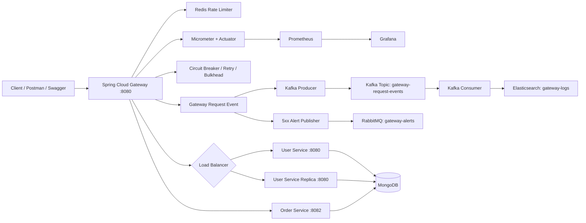

# Architecture

## Request lifecycle

- Gateway security validates a Bearer JWT using the shared signing secret.
- RedisRateLimiter applies an IP-keyed token bucket to User and Order routes.
- Spring Cloud LoadBalancer selects an instance from simple discovery entries.
- Circuit Breaker and Retry filters protect routed GET traffic; the fallback controller returns a JSON 503 when the circuit breaker opens.
- CorrelationIdGlobalFilter propagates `X-Correlation-ID`, measures latency, records in-memory observability counters, and publishes a `GatewayRequestEvent`.
- Kafka persists request-event messages for asynchronous processing. Consumer checks the Bloom filter and verifies possible duplicates against Elasticsearch before saving.
- RabbitMQ receives 5xx event alerts. The current consumer logs alerts; it is a demonstration notification sink, not an email/SMS delivery integration.
- GatewayMetricsFilter emits custom Micrometer counters/timers. Actuator exposes them for Prometheus.

## Docker network endpoints

Within Compose, services use DNS names: `redis:6379`, `kafka:29092`, `rabbitmq:5672`, `elasticsearch:9200`, `user-service:8080`, `user-service-replica:8080`, and `order-service:8082`. Host access uses the published ports in the README.
